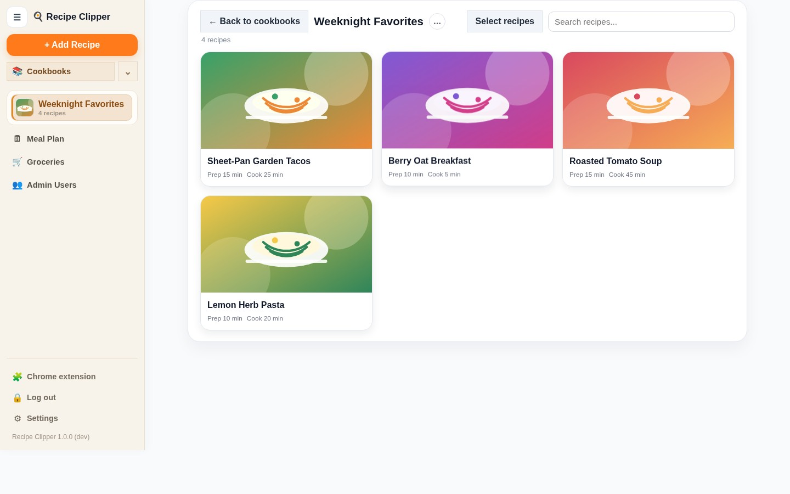
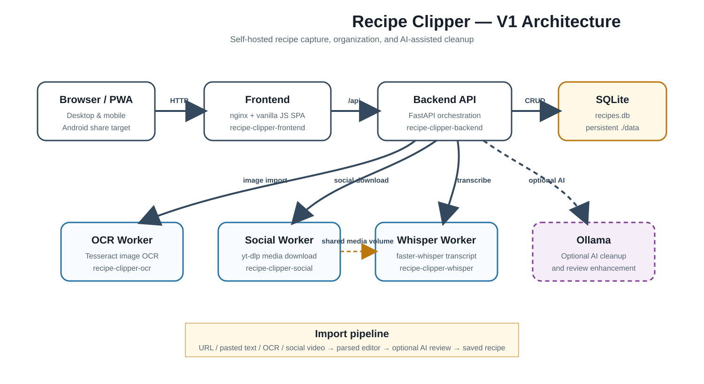

# Recipe Clipper

[](https://github.com/ckoenig673/recipe-clipper/actions/workflows/backend-tests.yml)
[](LICENSE)

Recipe Clipper is a self-hosted recipe capture and organization app. It imports recipes from public URLs, pasted text, images, and social videos, then lets users review, edit, organize, plan, and shop from one structured recipe library.

[Quick Start](#quick-start) · [Documentation](docs/README.md) · [Architecture](docs/architecture/README.md) · [Security](SECURITY.md)

## At a Glance

- Capture recipes from URLs, pasted text, images, and public social videos.
- Review structured imports before saving them to the library.
- Organize recipes into cookbooks, meal plans, and grocery lists.
- Run locally with Docker Compose and optional Ollama-assisted cleanup.
- Use the Android companion project as a share target.

## Product Preview

The library view below was captured from an isolated local demo populated entirely with synthetic recipes and artwork.



Recipe Clipper uses an [invite-only login](docs/screenshots/recipe-clipper-login.png) before users access their library.

## Project Status

Version `1.0.0` is the documented public V1 baseline. Until a matching GitHub tag and release are published, use the latest code on `main`.

The current regression baseline includes backend tests, frontend helper tests, and Playwright coverage for authentication, URL import, OCR import, pasted recipes, AI Cleanup review, mobile behavior, cookbook layout, and bulk recipe actions.

## Features

### Import and capture

- Import recipes from public HTTP and HTTPS recipe URLs.
- Paste full recipe text with deterministic title, section, notes, and list cleanup.
- Import photos, screenshots, and scanned pages through OCR.
- Download public social-video media and create recipes from Whisper transcripts.
- Accept Android share-target input through the included companion project.
- Show import-service status from Settings.

### Recipe editing and organization

- Review parsed recipes before saving.
- Organize recipes into cookbooks.
- Edit structured ingredient and instruction groups.
- Scale displayed ingredient quantities by servings.
- Use bulk selection, move, grocery-list, and delete actions.
- Maintain recipe state and personal notes.

### AI-assisted cleanup

- Run optional AI Cleanup against the saved structured recipe.
- Review proposed changes before applying them.
- Cancel without modifying the saved recipe.
- Accept meaningful structured changes only.
- Support a no-change result when the recipe is already well organized.
- Treat source pages and transcripts as optional supporting context rather than replacing the saved recipe.

### Planning and shopping

- Add recipes to a meal plan.
- Create grocery previews from recipes or meal-plan items.
- Maintain a checked grocery list.
- Remove grocery items by recipe source or clear completed items.

## Architecture



Recipe Clipper uses a deliberately small V1 architecture:

- `frontend` — nginx-hosted vanilla JavaScript SPA
- `backend` — FastAPI API, auth, SQLite access, imports, and orchestration
- `ocr` — Tesseract OCR worker
- `social` — yt-dlp media download worker
- `whisper` — faster-whisper transcription worker
- optional Ollama — AI Cleanup and review enhancement

Runtime container names:

- `recipe-clipper-frontend`
- `recipe-clipper-backend`
- `recipe-clipper-ocr`
- `recipe-clipper-social`
- `recipe-clipper-whisper`

See the [architecture overview](docs/architecture/README.md) for the request and import flows.

## Prerequisites

- Docker Engine with Docker Compose
- Local disk space for SQLite and temporary media artifacts
- Available host ports, by default:
  - `8010` frontend
  - `8015` backend
  - `8787` OCR
  - `8790` social download
  - `8791` Whisper

Ollama is optional. Core import, save, edit, cookbook, meal-plan, and grocery-list flows work without it.

## Quick Start

1. Copy the tracked environment template:

   ```bash
   cp .env.example .env
   ```

   PowerShell:

   ```powershell
   Copy-Item .env.example .env
   ```

2. Set a bootstrap administrator in `.env`:

   ```dotenv
   AUTH_BOOTSTRAP_ADMIN_EMAIL=admin@example.local
   AUTH_BOOTSTRAP_ADMIN_PASSWORD=replace-this-password
   ```

3. Optionally configure Ollama:

   ```dotenv
   OLLAMA_BASE_URL=http://host.docker.internal:11434
   OLLAMA_MODEL=llama3:latest
   ```

   Leave `OLLAMA_BASE_URL` blank to disable AI-dependent actions.

4. Build and start the stack:

   ```bash
   docker compose up -d --build
   ```

5. Open `http://localhost:8010` and sign in.

6. Open **Settings** and confirm the import services are reachable before testing OCR or social-video imports.

## Configuration

The tracked `.env.example` documents the complete runtime surface.

Important groups:

- Storage: `RECIPES_DB_PATH`
- Browser/auth: `AUTH_*`, `CORS_ALLOW_ORIGINS`
- Worker routing: `OCR_WORKER_URL`, `SOCIAL_DOWNLOADER_URL`, `WHISPER_PROCESSOR_URL`
- Worker ports: `OCR_WORKER_PORT`, `SOCIAL_DOWNLOADER_PORT`, `WHISPER_PROCESSOR_PORT`
- AI: `OLLAMA_BASE_URL`, `OLLAMA_MODEL`, `OLLAMA_TIMEOUT_SECONDS`
- Review behavior: `AI_REVIEW_ENABLED`, `AI_REVIEW_POLL_SECONDS`
- Social-media artifacts: `SOCIAL_VIDEO_TMP_DIR`, `SOCIAL_DOWNLOADER_OUTPUT_DIR`
- Whisper defaults: `WHISPER_MODEL`, `WHISPER_DEVICE`, `WHISPER_COMPUTE_TYPE`

`SOCIAL_DOWNLOADER_*` and `WHISPER_PROCESSOR_*` are legacy-compatible environment variable names retained by the current runtime. They point to the current `social-worker` and `whisper-worker` services.

Real credentials, cookies, and environment overrides belong in `.env`, which must not be committed.

## Repository Layout

- `backend/` — API, persistence, authentication, parsers, and orchestration
- `frontend/` — SPA, nginx configuration, PWA assets, and Playwright tests
- `ocr-worker/` — OCR worker
- `social-worker/` — media download worker
- `whisper-worker/` — transcription worker
- `android-share-companion/` — Android share-target project
- `docs/architecture/` — architecture and runtime flows
- `docs/development/` — regression fixture and maintenance guidance
- `.github/` — issue, pull-request, CI, and security automation templates

## Validation

Run from the repository root:

```bash
docker compose config
python -m pytest backend/tests/
node --test frontend/tests/url-hostname-helpers.test.mjs
npm run test:e2e
```

Interactive browser run:

```bash
npm run test:e2e:headed
```

## Documentation

- [Documentation index](docs/README.md)
- [Architecture overview](docs/architecture/README.md)
- [Good fixture guidelines](docs/development/good-fixture-guidelines.md)
- [Manual smoke checklist](docs/development/manual-smoke-checklist.md)
- [Contributing guide](CONTRIBUTING.md)
- [Security policy](SECURITY.md)
- [Changelog](CHANGELOG.md)
- [Screenshot standards](docs/screenshots/README.md)
