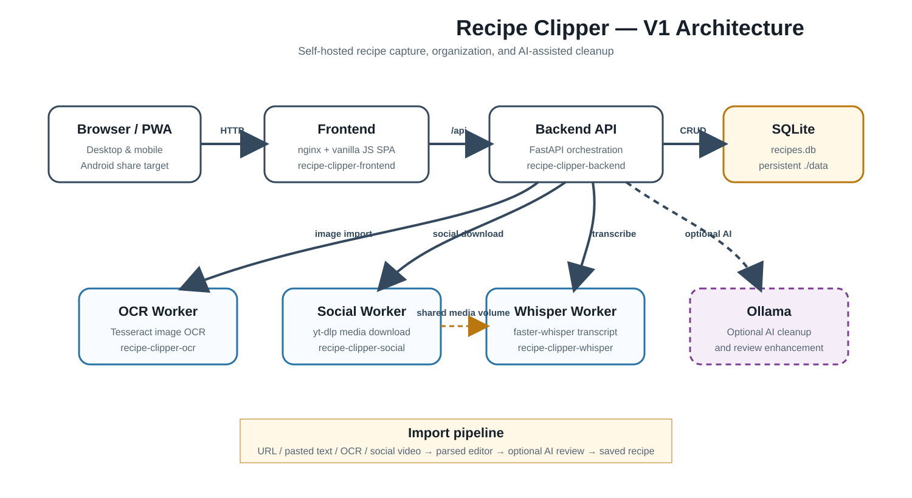

# Recipe Clipper Documentation

## Start here

- [Project README](../README.md)
- [Deployment guide](deployment/README.md)
- [Architecture overview](architecture/README.md)
- [Manual smoke checklist](development/manual-smoke-checklist.md)
- [Good fixture guidelines](development/good-fixture-guidelines.md)
- [Dependency and container pinning](development/dependency-locks.md)
- [Version 2 backlog](development/v2-backlog.md)
- [Screenshot standards](screenshots/README.md)
- [Release process](releases/README.md)
- [Version 1.0.0 release notes](releases/v1.0.0.md)

## Repository policies

- [Contributing](../CONTRIBUTING.md)
- [Security](../SECURITY.md)
- [Changelog](../CHANGELOG.md)

## Development references

- [Public repository audit](development/public-repository-audit.md)
- [CodeQL regular-expression inventory](development/codeql-regex-inventory.md)

## Documentation conventions

- Keep the root README focused on installation, capabilities, and first-run verification.
- Keep architecture and service-routing details under `docs/architecture/`.
- Keep test-fixture and maintenance procedures under `docs/development/`.
- Store sanitized project images and diagrams under `docs/screenshots/`.
- Capture screenshots only from synthetic demo data and verify that no account, recipe, host, or secret information is visible.
- Update documentation in the same pull request whenever routes, environment variables, worker names, ports, or user workflows change.
