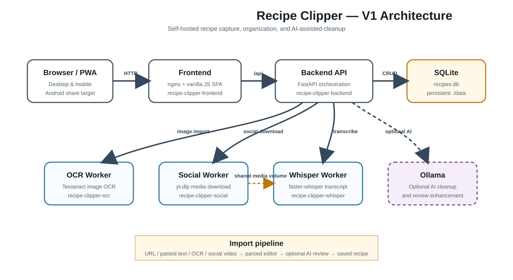

# Recipe Clipper Architecture

Recipe Clipper `1.0.0` uses a small Docker Compose architecture with one application backend and isolated workers for CPU-heavy or dependency-heavy import tasks.



## Components

### Frontend

The `frontend` service serves the vanilla JavaScript SPA through nginx.

Responsibilities:

- Authentication UI
- Cookbook and recipe navigation
- URL, image, pasted-text, and shared-recipe import workflows
- Parsed recipe review and editing
- AI Cleanup review
- Meal planning and grocery lists
- Admin and import settings
- Import-service status display

The frontend calls the backend through nginx under `/api/`.

### Backend

The `backend` service is the application orchestrator and system of record.

Responsibilities:

- Session authentication and administrator controls
- Recipe and cookbook CRUD
- SQLite persistence
- Import orchestration
- URL validation and safe outbound fetching
- HTML parsing and sanitization
- OCR and social-worker coordination
- AI Cleanup and review state
- Meal-plan and grocery-list APIs
- Import-service health aggregation

### SQLite

SQLite is the V1 system of record. The database is mounted under `/app/data` in the backend container and persisted from the host `./data` directory.

### OCR worker

The `ocr` service accepts image uploads and returns OCR text through Tesseract.

Default endpoint:

```text
http://ocr:8787/ocr/image
```

### Social worker

The `social` service downloads public social-video media with yt-dlp and stores the result in the shared social-download directory.

Default endpoint:

```text
http://social:8790/download/social-video
```

### Whisper worker

The `whisper` service transcribes downloaded audio with faster-whisper.

Default endpoint:

```text
http://whisper:8791/transcribe
```

The social and Whisper workers do not need to call each other directly. The backend orchestrates the stages, while both workers share the mounted media directory.

### Ollama

Ollama is optional. When configured, the backend uses it for AI Cleanup and review enhancement. Core recipe capture and organization must remain usable without Ollama.

## Primary request flows

### Standard URL import

1. Frontend submits a public recipe URL.
2. Backend validates the scheme, hostname, resolved address, and redirects.
3. Backend downloads and sanitizes the page.
4. Structured data and supported DOM recipe candidates are parsed.
5. Frontend opens the parsed editor.
6. The user may run AI Cleanup, edit the recipe, and save it.

### Image OCR import

1. Frontend uploads an image.
2. Backend forwards the image to the OCR worker.
3. OCR text is parsed deterministically.
4. Optional AI processing may improve structure without discarding valid deterministic fields.
5. Frontend opens the parsed editor.

### Social-video transcript import

1. Backend attempts normal social recipe URL resolution.
2. When no external recipe is available, the backend calls the social worker.
3. The downloaded media is stored in the shared volume.
4. Backend calls the Whisper worker for transcription.
5. Transcript text is classified and converted into a structured recipe.
6. Explicit transcript evidence may conservatively repair suspicious extracted quantities.
7. Frontend opens the parsed editor.

### Saved-recipe AI Cleanup

1. Backend loads the currently saved structured recipe.
2. Source URL or saved transcript context is optional supporting evidence.
3. AI returns a proposed structured recipe or a no-change result.
4. Frontend displays only meaningful changed sections.
5. The user explicitly applies or cancels the proposal.

## Service communication

Compose service names are used inside the Docker network:

| Service | Internal role | Default internal endpoint |
|---|---|---|
| `frontend` | SPA and API proxy | `http://frontend` |
| `backend` | FastAPI orchestrator | `http://backend:8000` |
| `ocr` | OCR | `http://ocr:8787/ocr/image` |
| `social` | Media download | `http://social:8790/download/social-video` |
| `whisper` | Transcription | `http://whisper:8791/transcribe` |

Runtime container names remain:

- `recipe-clipper-frontend`
- `recipe-clipper-backend`
- `recipe-clipper-ocr`
- `recipe-clipper-social`
- `recipe-clipper-whisper`

## Persistence and shared files

- `./data/recipes.db` — SQLite database
- `./data/social-downloads` — media shared by backend, social, and Whisper services

Generated data, media, logs, caches, and test output must remain outside version control.

## Security boundaries

- User-controlled outbound URLs pass through centralized public-URL validation.
- Redirect targets are revalidated.
- Private, loopback, link-local, reserved, metadata, and credential-bearing destinations are blocked.
- Parsed hostname matching replaces security-sensitive substring checks.
- Untrusted HTML is parsed and sanitized structurally.
- User recipe text is rendered through safe DOM construction.
- Internal exceptions are logged server-side and converted into stable client responses.

## V1 design principles

- Prefer a small, understandable self-hosted stack.
- Keep SQLite as the V1 system of record.
- Do not add Redis, Celery, Kafka, or WebSockets without a demonstrated need.
- Preserve deterministic parsing and use AI as a reviewed enhancement.
- Make source URL failures non-fatal to saved-recipe cleanup.
- Add regression fixtures for real import defects.
- Modularize the large backend and frontend files incrementally as future stories touch them.
